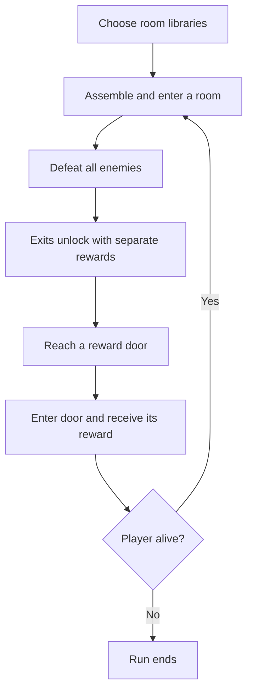

# Masmorra

**Masmorra is a portrait action game about gesture-based combat, with strong roguelite influences.**

The project is in development and built with Godot 4.7. It uses a **720 × 1280 portrait viewport**. Gameplay and interface text are in Portuguese.

## Game systems

- **Input:** touch strokes control movement and trigger equipped actions.
- **Rooms:** selected room libraries supply pieces for connected, assembled rooms.
- **Encounters:** enemies spawn in each room. The number of enemies increases as the run progresses.
- **Rewards:** after the encounter, exits unlock. Each exit has a separate upgrade, health, or stamina reward.
- **Upgrades:** passive upgrades persist between rooms and gain a level when collected again.
- **Enemies:** current types are the purple-head dash attacker and the triangular route obstacle.
- **Interface:** health and stamina bars, minimap, reward indicators, and upgrade backpack.

## Getting started

1. Install **Godot 4.7**.
2. Clone or download this repository.
3. In Godot's Project Manager, choose **Import** and select the repository's `project.godot` file.
4. Open the project and run the main scene with **F6**, or run the project with **F5**.

The project uses portrait orientation and touch input. Keyboard movement actions are defined in `project.godot`. Player-facing text is in Portuguese.

## How a run works

1. **Configure the room pool.** In the start menu, select which room libraries are enabled. The selection is saved locally between runs.
2. **Generate a room.** The assembler combines pieces from the enabled libraries. The room is built with a player spawn, enemy spawn points, and exits.
3. **Complete the encounter.** Exits remain locked until all enemies in the room are defeated. The number of enemies increases in later rooms.
4. **Choose an exit.** Each unlocked exit displays its own reward: an upgrade, health, or stamina. Reward indicators point toward the corresponding doors. Tapping an indicator moves the player in front of its door; entering the door selects that reward.
5. **Continue or end the run.** The next room is generated and the selected reward is granted. The player's upgrades persist and can gain levels when collected again. The run ends when the player's health reaches zero.



`PieceAssembler` loads enabled libraries. Shared rules validate pieces and entry seeds, assemble a connected layout, and pass it to `GeneratedRoom` for construction.

## Project map

| Path | Responsibility |
| --- | --- |
| `scenes/` | Main scene, player and enemy scenes, generated room, menus, HUD, and upgrade scenes. |
| `scripts/input/` | Touch strokes, smoothing, and gesture recognition. |
| `scripts/abilities/` | Player actions and the runtime ability controller. |
| `scripts/gameplay/` | Health, enemies, room assembly and transitions, and reward selection. |
| `scripts/upgrades/` | Modular passive upgrades, projectiles, and temporary effects. |
| `scripts/ui/` | Start menu, minimap, reward guides, backpack, and HUD components. |
| `resources/rewards/` | Data resources that connect a reward's name, icon, world, and upgrade scene. |
| `piece-libraries/` | Exported room-piece libraries available to the game. |
| `room-decks/` | Room deck data and documentation. |
| `assets/` | Sprites, fonts, tiles, and upgrade icons. |
| `tests/` | Godot scripts covering controls, gameplay, generation, and enemies. |

### Code entry points

- **Upgrade:** its behavior is under `scripts/upgrades/`, its scene under `scenes/upgrades/`, and its reward data under `resources/rewards/`.
- **Gesture recognition:** `scripts/input/`. Ability behavior: `scripts/abilities/`.
- **Room assembly:** `scripts/gameplay/piece_assembler.gd` and `scripts/gameplay/piece_rules.gd`.
- **HUD:** `scripts/ui/` and the corresponding nodes in `scenes/main.tscn`.

## Code conventions

- Write code, identifiers, and code comments in **English**.
- Keep player-facing text in **Portuguese**.
- Keep gesture recognition, movement, and ability behavior in separate components.
- Keep upgrades modular so they can be equipped, leveled, and removed at runtime.
- Put prototype starting loadouts and tuning values in scene configuration or the Inspector where practical.

## Tests

The `tests/` directory contains individual Godot scripts, including `test_controls.gd`, `test_gameplay.gd`, `test_generation.gd`, `test_survival_loop.gd`, and `test_triangular.gd`. From the project root, run a script in headless mode:

```sh
godot --headless --path . --script res://tests/test_generation.gd
```

Replace the script path to run a different test.
