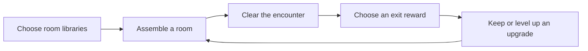

# Masmorra

> A portrait action game about gesture-based combat, assembled dungeon rooms, and building a stronger character one reward at a time.


Masmorra is an active prototype. Its main scene combines touch gestures, room-piece assembly, escalating enemy encounters, and passive upgrades that persist throughout a run. The project targets a **720 × 1280 portrait viewport**.

## What is in the game

- **Gesture controls:** draw strokes on the screen to move and trigger equipped actions.
- **Room runs:** choose room libraries, clear encounters, and travel through connected exits.
- **Reward choices:** each unlocked exit offers a different upgrade or a health or stamina boost.
- **Passive builds:** upgrades can level up when collected again and remain equipped between rooms.
- **Enemy prototypes:** fight the purple-head dash attacker and the triangular route obstacle.
- **Mobile-focused HUD:** health, stamina, minimap, reward direction indicators, and an upgrade backpack.

## Getting started

1. Install **Godot 4.7**.
2. Clone or download this repository.
3. In Godot's Project Manager, choose **Import** and select the repository's `project.godot` file.
4. Open the project and run the main scene with **F6**, or run the project with **F5**.

The game is designed for portrait play and touch input. Keyboard movement actions are also defined in `project.godot` for development. Menus and other player-facing text are in Portuguese.

## How a run fits together



Room libraries are loaded by `PieceAssembler`. The shared rules prepare valid pieces and seeds, assemble a connected layout, and pass it to `GeneratedRoom` to create floors, walls, spawn points, and exits. The selected library list is saved locally between runs.

## Project map

| Path | Responsibility |
| --- | --- |
| `scenes/` | Main scene, player and enemy scenes, generated room, menus, HUD, and upgrade scenes. |
| `scripts/input/` | Touch strokes, smoothing, and gesture recognition. |
| `scripts/abilities/` | Player actions and the runtime ability controller. |
| `scripts/gameplay/` | Health, enemies, room assembly and transitions, and reward selection. |
| `scripts/upgrades/` | Modular passive upgrades, projectiles, and temporary effects. |
| `scripts/ui/` | Start menu, minimap, reward guides, backpack, and HUD components. |
| `resources/rewards/` | Data resources that connect a reward's name, icon, world, and upgrade scene. |
| `piece-libraries/` | Exported room-piece libraries available to the game. |
| `room-decks/` | Room deck data and documentation. |
| `assets/` | Sprites, fonts, tiles, and upgrade icons. |
| `tests/` | Godot scripts covering controls, gameplay, generation, and enemies. |

### Where to make a change

- **Add or tune a passive:** edit its script under `scripts/upgrades/`, its scene under `scenes/upgrades/`, and its reward resource under `resources/rewards/`.
- **Change a gesture:** start in `scripts/input/`; action behavior belongs in `scripts/abilities/`.
- **Change room assembly:** start with `scripts/gameplay/piece_assembler.gd` and `scripts/gameplay/piece_rules.gd`.
- **Change a HUD element:** look in `scripts/ui/` and its corresponding scene or node in `scenes/main.tscn`.

## Code conventions

- Write code, identifiers, and code comments in **English**.
- Keep player-facing text in **Portuguese**.
- Keep gesture recognition, movement, and ability behavior in separate components.
- Keep upgrades modular so they can be equipped, leveled, and removed at runtime.
- Put prototype starting loadouts and tuning values in scene configuration or the Inspector where practical.

## Tests

The `tests/` folder contains individual Godot scripts, including `test_controls.gd`, `test_gameplay.gd`, `test_generation.gd`, `test_survival_loop.gd`, and `test_triangular.gd`. Run the relevant script with Godot's headless mode from the project root, for example:

```sh
godot --headless --path . --script res://tests/test_generation.gd
```

Replace the test path to run another suite. Tests are not launched automatically by the project.
