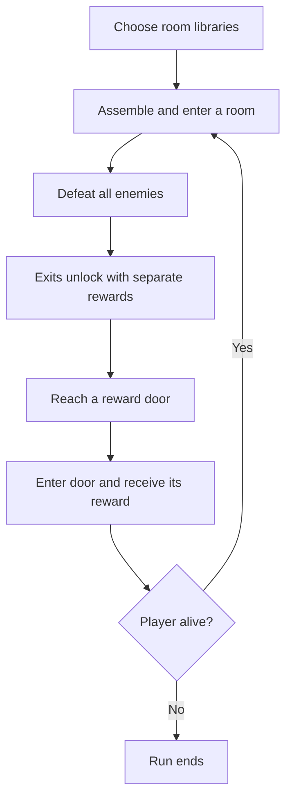

# Masmorra

**Masmorra is a portrait action game about gesture-based combat, with strong roguelite influences.**


The project is built with Godot 4.7. Gameplay and interface text are in Portuguese.

> **Project status:** in development. Features and balance may change.

<details>
<summary>Contents</summary>

- [Game systems](#game-systems)
- [Getting started](#getting-started)
- [How a run works](#how-a-run-works)
- [Project map](#project-map)
- [Code entry points](#code-entry-points)
- [Code conventions](#code-conventions)
- [Tests](#tests)

</details>

---

## Game systems

| System | Current behavior |
| --- | --- |
| Input | Touch strokes control movement and trigger equipped actions. |
| Rooms | Selected room libraries supply pieces for connected, assembled rooms. |
| Encounters | Enemies spawn in each room; their number increases as the run progresses. |
| Rewards | After the encounter, exits unlock. Each exit offers a separate upgrade, health, or stamina reward. |
| Upgrades | Passive upgrades persist between rooms and gain a level when collected again. |
| Enemies | Current types are the purple-head dash attacker and the triangular route obstacle. |
| Interface | Health and stamina bars, minimap, reward indicators, and upgrade backpack. |

## Getting started

1. Install **Godot 4.7** and clone or download this repository.
2. In Godot's Project Manager, choose **Import** and select `project.godot`.
3. Open the project. Press **F6** to run the main scene, or **F5** to run the project.

> The project uses portrait orientation with a **720 × 1280** base viewport. Touch input is supported. Keyboard movement actions are defined in `project.godot` for development.

## How a run works

1. **Configure the room pool** in the start menu. The enabled room libraries are saved locally between runs.
2. **Generate and enter a room.** The assembler combines pieces from the enabled libraries and builds a room with a player spawn, enemy spawn points, and exits.
3. **Complete the encounter.** Exits remain locked until every enemy is defeated. Enemy counts increase in later rooms.
4. **Select a reward.** Each unlocked exit displays its own upgrade, health, or stamina reward. Indicators point toward the doors. Tapping an indicator moves the player in front of that door; entering it selects the reward.
5. **Continue the run.** The next room is generated and the selected reward is granted. Upgrades persist and gain levels when collected again. The run ends when the player's health reaches zero.



<details>
<summary>Room assembly details</summary>

`PieceAssembler` loads enabled libraries. Shared rules validate pieces and entry seeds, assemble a connected layout, and pass it to `GeneratedRoom` for construction.

</details>

## Project map

| Path | Responsibility |
| --- | --- |
| `scenes/` | Main scene, player and enemy scenes, generated room, menus, HUD, and upgrade scenes. |
| `scripts/input/` | Touch strokes, smoothing, and gesture recognition. |
| `scripts/abilities/` | Player actions and the runtime ability controller. |
| `scripts/gameplay/` | Health, enemies, room assembly and transitions, and reward selection. |
| `scripts/upgrades/` | Modular passive upgrades, projectiles, and temporary effects. |
| `scripts/ui/` | Start menu, minimap, reward guides, backpack, and HUD components. |
| `resources/rewards/` | Data resources that connect a reward's name, icon, world, and upgrade scene. |
| `piece-libraries/` | Exported room-piece libraries available to the game. |
| `room-decks/` | Room deck data and documentation. |
| `assets/` | Sprites, fonts, tiles, and upgrade icons. |
| `tests/` | Godot scripts covering controls, gameplay, generation, and enemies. |

### Code entry points

- **Upgrade:** its behavior is under `scripts/upgrades/`, its scene under `scenes/upgrades/`, and its reward data under `resources/rewards/`.
- **Gesture recognition:** `scripts/input/`. Ability behavior: `scripts/abilities/`.
- **Room assembly:** `scripts/gameplay/piece_assembler.gd` and `scripts/gameplay/piece_rules.gd`.
- **HUD:** `scripts/ui/` and the corresponding nodes in `scenes/main.tscn`.

## Code conventions

> **Language:** code, identifiers, and code comments are in English. Player-facing text is in Portuguese.

- Gesture recognition, movement, and ability behavior belong in separate components.
- Upgrades are modular and can be equipped, leveled, and removed at runtime.
- Prototype starting loadouts and tuning values are configured in scenes or the Inspector where practical.

## Tests

The `tests/` directory contains individual Godot scripts, including `test_controls.gd`, `test_gameplay.gd`, `test_generation.gd`, `test_survival_loop.gd`, and `test_triangular.gd`. From the project root, run a script in headless mode:

```sh
godot --headless --path . --script res://tests/test_generation.gd
```

Replace the script path to run another test.
